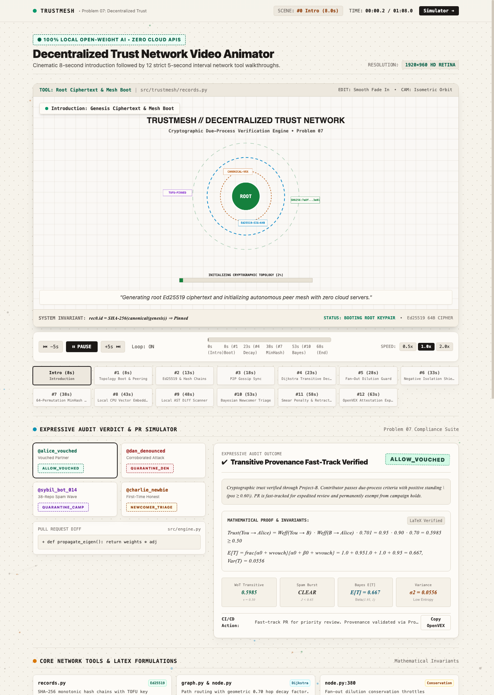

# TrustMesh: Decentralized Open-Source Trust Network

[](https://dhruvv26420-jpg.github.io/Check_All_In/)
[](Check_All_In.pptx)
[](Check_All_In.pdf)
[](LICENSE)
[](https://www.python.org/downloads/)
[](#dependencies)
[](#local-open-weight-ai)

> 🌐 **Interactive Web Experience:** [Launch Live Platform](https://dhruvv26420-jpg.github.io/Check_All_In/) · Featuring the 60fps HD Canvas Video Animator, Real-Time PR Audit Simulator with KaTeX proofs, and GitHub-themed Code Inspector.

<p align="center">
  <a href="https://dhruvv26420-jpg.github.io/Check_All_In/">
    
  </a>
</p>

**TrustMesh** is a decentralized, peer-to-peer cryptographic trust scoring and reputation network designed for open-source maintainers during high-volume contribution events such as Hacktoberfest.

It enables maintainers to collaboratively identify and triage coordinated PR spam campaigns and malicious actors across repositories without relying on centralized reputation silos, closed cloud APIs, or vendor lock-in.

---

## 🌟 Highlights & Core Architectural Guarantees

* 🔒 **Cryptographically Grounded:** Ed25519-signed, SHA-256 content-addressed records with per-issuer monotonic hash chains (`verify_chain`) and Trust-On-First-Use (TOFU) key pinning against impersonation.
* 🌐 **Fully Decentralized (P2P Gossip):** Peer-to-peer set-difference gossip protocol with zero central databases, cloud dependencies, or single point of failure.
* ⚖️ **Due-Process Invariants & Newcomer Safeguards:**
  * **Guaranteed Newcomer Probation:** Accounts with no prior history always receive `PROBATION` (or `HONEST_NEWCOMER_TRIAGE`) via Bayesian Laplace prior $E[T] = 0.50$ and high epistemic uncertainty ($\text{Var} = 0.0833$)—**never automatic rejection or blocks**.
  * **Single Accusation Protection:** A single maintainer can **never** trigger a network-wide `BLOCK`.
  * **Verified Evidence Factor:** Denouncements require cited near-duplicate PR fingerprints verified by receiver math.
  * **Bayesian Serial Smearer Penalty:** Uncorroborated accusers lose reputation weight exponentially via $\text{Beta}(2, 1)$ updates.
  * **Asymmetric Negative Isolation:** Hostile untrusted denouncements are quarantined into `denouncements_ignored` and cannot poison a contributor's standing.
  * **Cryptographic Retraction Support:** Maintainers can cryptographically revoke past denouncements or vouches (`RecordKind.RETRACT`).
  * **Established Exemption:** Contributors with $\text{pos} \ge 0.60$ are exempt from automated campaign `HOLD`.
* 🤖 **Dual-Layer Coordinated Campaign Defense:**
  1. **Deterministic 64-Permutation MinHash + LSH Banding:** Ultra-fast $O(1)$ candidate pairing collapsing synonym and phrasing variations.
  2. **Local Open-Weight Semantic Embeddings (`all-MiniLM-L6-v2`):** Dense 384-dimensional vector similarity running 100% locally on CPU without external API calls.

---

## 📦 Repository Structure

```
trustmesh/
├── src/
│   └── trustmesh/
│       ├── __init__.py      # Package exports and unified API
│       ├── records.py       # Ed25519 signatures, content addressing, hash chains (verify_chain)
│       ├── node.py          # Project Node, transitive trust calculation, gossip, evaluate()
│       ├── graph.py         # NetworkX-backed Web-of-Trust graph engine & Dijkstra path attenuation
│       ├── campaign.py      # Dual-layer MinHash LSH + SentenceTransformers campaign detector
│       ├── evaluator.py     # Unified evaluation engine & Bayesian newcomer triage
│       ├── models.py        # Pydantic data models & OpenVEX attestation schemas
│       └── cli.py           # Command-line interface entry point
├── tests/
│   ├── test_records.py      # Signature verification, tampering, key pinning, chain gaps
│   ├── test_node.py         # Transitive decay, sybils, retractions, Beta reliability
│   ├── test_campaign.py     # MinHash LSH & SentenceTransformers campaign tests
│   ├── test_graph.py        # Directed graph peering, Dijkstra attenuation, negative isolation
│   ├── test_evaluator.py    # Unified evaluation and Bayesian newcomer triage tests
│   ├── test_simulation.py   # 50-repository ecosystem simulation
│   ├── test_smoke.py        # Smoke tests and model registry verification
│   └── test_end_to_end.py   # Scaled-down multi-node integration test
├── docs/
│   └── DESIGN.md            # Comprehensive mathematical derivations & architectural specification
├── scripts/
│   └── audit_compliance.py # Hackathon rules verification & safety audit script
├── examples/
│   ├── network_input.json   # Sample graph topology
│   ├── sample_contribution.json # Sample PR contribution metadata
│   ├── sample_trust_score.json  # Sample evaluation score output
│   └── audit_output.json    # Machine-readable compliance report
├── demo_unified.py          # Interactive 4-persona test harness (Alice, Dan, Sybil, Charlie)
├── demo_campaign.py         # Spam wave clustering demo
├── demo_local.py            # Local graph evaluation demo
├── pyproject.toml           # Project configuration & dependencies
├── HACKATHON.md             # Hack Day Sonipat Problem 07 documentation
└── LICENSE                  # MIT License
```

---

## 🚀 Quick Start

### Installation
TrustMesh requires **Python 3.10+**:

```bash
pip install -e .
```

### 1. Run the Unified Interactive Demonstration
Runs the 4-persona decision audit matrix (Vouched fast-track, Peer denouncement quarantine, Sybil cluster block, and Honest newcomer Bayesian triage with OpenVEX JSON attestation):

```bash
python3 demo_unified.py
```

### 2. Run the Compliance & Safety Audit
Verifies repository compliance against hackathon rules (no closed cloud AI keys, valid open-weight model references, clean git practices):

```bash
python3 scripts/audit_compliance.py
```

### 3. Run the Full Test Suite
```bash
pytest tests/ -v
```

---

## 📊 Verdict Taxonomy

Maintainer evaluations return standardized verdicts adhering to Problem 07:

| Verdict | Meaning | Action Recommended |
| :--- | :--- | :--- |
| **`TRUST` / `ALLOW_VOUCHED`** | Contributor has strong positive reputation ($\text{pos} \ge 0.60$). | Fast-track PR for merge review; exempt from campaign triage. |
| **`ALLOW`** | Mild positive reputation ($\text{pos} \ge 0.20$ and $\text{pos} \ge \text{neg}$). | Standard code review. |
| **`PROBATION` / `HONEST_NEWCOMER_TRIAGE`** | Newcomer or account with zero prior network history. | Route to human review queue; **never reject or block**. |
| **`FLAG`** | Isolated unverified grievance or low negative signal ($\text{neg} > \text{pos}$). | Review code with extra scrutiny; informational warning only. |
| **`HOLD` / `QUARANTINE_CAMPAIGN`** | Account identified as member of multi-project spam burst ($\ge 3$ PRs in $\ge 3$ repos). | Hold for human triage review; **never auto-block**. |
| **`BLOCK` / `QUARANTINE_DENOUNCED`** | Direct maintainer policy or $\ge 2$ independent trusted issuers ($\text{neg} \ge 0.70$). | Automated rejection / block. |

---

## 📐 Mathematical Foundations

1. **Transitive Path Attenuation:**
   $$\text{Trust}(A \to C) = W(A \to B) \times W(B \to C) \times 0.70^{\text{hops} - 1}$$
2. **Fan-Out Dilution Conservation:**
   $$W_{\text{eff}}(u \to v) = W(u \to v) \times \min\left(1.0, \frac{8.0}{K_u}\right) \quad \text{where } K_u = |\text{Peers}(u)|$$
3. **Bayesian Epistemic Uncertainty (Cold-Start Newcomers):**
   $$E[T] = \frac{\alpha}{\alpha + \beta} = 0.50, \quad \text{Var}(T) = \frac{\alpha \beta}{(\alpha + \beta)^2(\alpha + \beta + 1)} = \frac{1}{12} \approx 0.0833$$
4. **Bayesian Issuer Reliability:**
   $$R(\text{issuer}) = \min\left(1.0, \frac{\alpha}{\alpha + \beta} \times \frac{3}{2}\right), \quad \alpha_0 = 2, \beta_0 = 1$$

---

## 📄 License
This project is licensed under the [MIT License](LICENSE).
